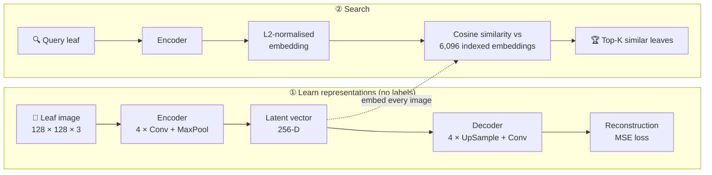
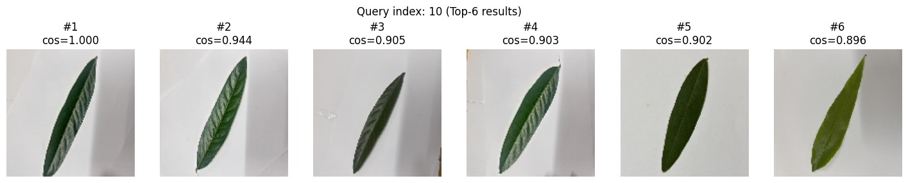
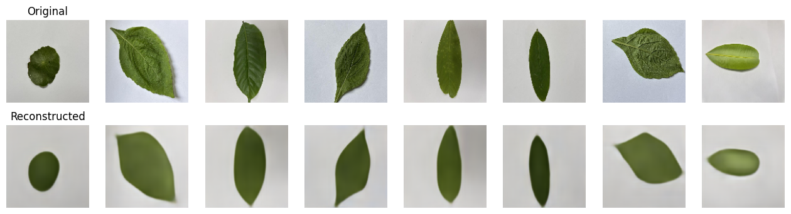

<div align="center">

<a href="#-retrieval-results"></a>

<br/>


</div>

---

## 📌 Overview

Medicinal plants are often identified by their leaves, but many species look alike to an untrained eye. This project builds a **search-by-image system**: give it a photo of a leaf, and it returns the most visually similar leaves from a collection of 6,096 images across 15 medicinal species.

A **convolutional autoencoder** learns to compress each 128 × 128 image into a **256-dimensional embedding** without using any labels. Those embeddings are L2-normalised and indexed, so retrieval becomes a fast **cosine-similarity** lookup.

<table>
<tr>
<td align="center"><b>6,096</b><br/>images</td>
<td align="center"><b>15</b><br/>species</td>
<td align="center"><b>256-D</b><br/>embeddings</td>
<td align="center"><b>0.815</b><br/>SSIM</td>
<td align="center"><b>25.17 dB</b><br/>PSNR</td>
<td align="center"><b>Top-K</b><br/>retrieval</td>
</tr>
</table>

---

## ✨ Highlights

<table>
<tr>
<td width="50%"><a href="#-dataset"></a></td>
<td width="50%"><a href="#-model"></a></td>
</tr>
<tr>
<td width="50%"><a href="#-reconstruction-quality"></a></td>
<td width="50%"><a href="#-retrieval-results"></a></td>
</tr>
</table>

---

## 🔄 How It Works



---

## 🔍 Retrieval Results

<div align="center">

**Query → Top-6 most similar leaves (cosine similarity)**




</div>

> [!NOTE]
> In the first demo an uploaded **Neem** leaf was used as the query, and **all six retrieved images are Neem leaves**, found without ever showing the model a species label. Result #1 is the same photo already present in the collection (cosine ≈ 1.0); the real test is results #2–#6, which share the query's serrated margin, shape and colour.

---

## 📊 Reconstruction Quality

| Metric (validation set, 1,220 images) | Value |
|:--|:--:|
| **MSE** | `0.00344` |
| **PSNR** | `25.17 dB` |
| **SSIM** | `0.815` |

<div align="center">



<sub>Top: original leaves · Bottom: autoencoder reconstructions</sub>


<sub>Training and validation MSE converge smoothly with no sign of overfitting</sub>

</div>

> [!TIP]
> **What the model actually learns:** reconstructions keep leaf **shape, size, orientation and colour** but blur fine vein texture. Retrieval therefore groups leaves mainly by silhouette and colour, which explains both its strengths and the next improvement below (contrastive / metric learning to capture texture).

---

## 📂 Dataset

Folder-based medicinal leaf dataset with **15 species** and **6,096 images**, resized to 128 × 128 × 3 and scaled to [0, 1]. Split 80 / 20 into **4,876 training** and **1,220 validation** images.

<details>
<summary><b>🌿 The 15 species</b></summary>
<br/>

| | | | | |
|:--|:--|:--|:--|:--|
| Ashok | Basil | Cordia | Debdaru | Heaven Lotus |
| Jarul | Mastwood | Minjiri | Nageshor | Neem |
| Punnag | Royna | Telakucha | Thankuni | Vasaka |

</details>

> Dataset images are not included in this repository.

---

## 🧠 Model

<details open>
<summary><b>Architecture (9.77 M parameters)</b></summary>
<br/>

| Block | Layers | Output |
|:--|:--|:--|
| Input | — | 128 × 128 × 3 |
| Encoder 1–4 | Conv2D (32 → 64 → 128 → 256, 3 × 3, ReLU) each followed by MaxPool 2 × 2 | 8 × 8 × 256 |
| Bottleneck | Flatten → Dense | **256** (latent embedding) |
| Decoder entry | Dense → Reshape | 8 × 8 × 256 |
| Decoder 1–4 | UpSampling 2 × 2 + Conv2D (256 → 128 → 64 → 32, ReLU) | 128 × 128 × 32 |
| Output | Conv2D (3, sigmoid) | 128 × 128 × 3 |

</details>

<details>
<summary><b>⚙️ Training configuration</b></summary>
<br/>

| Setting | Value |
|:--|:--|
| Loss | Mean squared error |
| Optimizer | Adam, learning rate 1e-3 |
| Batch size | 32 |
| Epochs | 12 |
| Callbacks | ModelCheckpoint (best val loss), EarlyStopping (patience 3), ReduceLROnPlateau (×0.5, patience 2) |
| Retrieval | L2-normalised embeddings, cosine similarity via dot product |

</details>

---

## 🚀 Getting Started

```bash
git clone https://github.com/RamzanPUCIT/medicinal-leaf-cbir-autoencoder.git
```

1. Open `Medicinal_Leaf_Dataset.ipynb` in **Google Colab**.
2. Mount Google Drive and set `DATASET_PATH` to the folder containing the 15 species sub-folders.
3. Run the cells in order: training and checkpointing → reconstructions and metrics → embedding extraction → retrieval demo.

Outputs (`ae_best.weights.h5`, `encoder.keras`, `embeddings.npy`, `filepaths.txt`) are saved to `MyDrive/leaf_cbir_outputs/`.

---

## 🗂️ Repository Structure

```
medicinal-leaf-cbir-autoencoder/
├── Medicinal_Leaf_Dataset.ipynb   # Training, evaluation, embeddings and retrieval
├── assets/
│   ├── readme/                    # Animated README graphics (SVG)
│   └── screenshots/               # Loss curve, reconstructions, retrieval demos
├── LICENSE                        # MIT
└── README.md
```

---

## 🔭 Future Work

- [ ] Report retrieval metrics (Precision@K, mAP) using species labels, excluding the self-match
- [ ] Metric learning (contrastive / triplet loss) so embeddings capture vein texture, not just shape
- [ ] Compare against pretrained CNN / ViT features as a baseline
- [ ] Streamlit app for uploading a leaf photo and browsing results
- [ ] Deploy on Hugging Face Spaces with Docker

---

## 👨‍💻 Author

**Muhammad Ramzan** · M.Phil Artificial Intelligence, PUCIT (University of the Punjab), Lahore

[](https://linkedin.com/in/ramzan-ai)
[](https://github.com/RamzanPUCIT)
[](mailto:founders786@gmail.com)

<div align="center">

⭐ **If this project helped you, consider giving it a star!** ⭐


</div>
